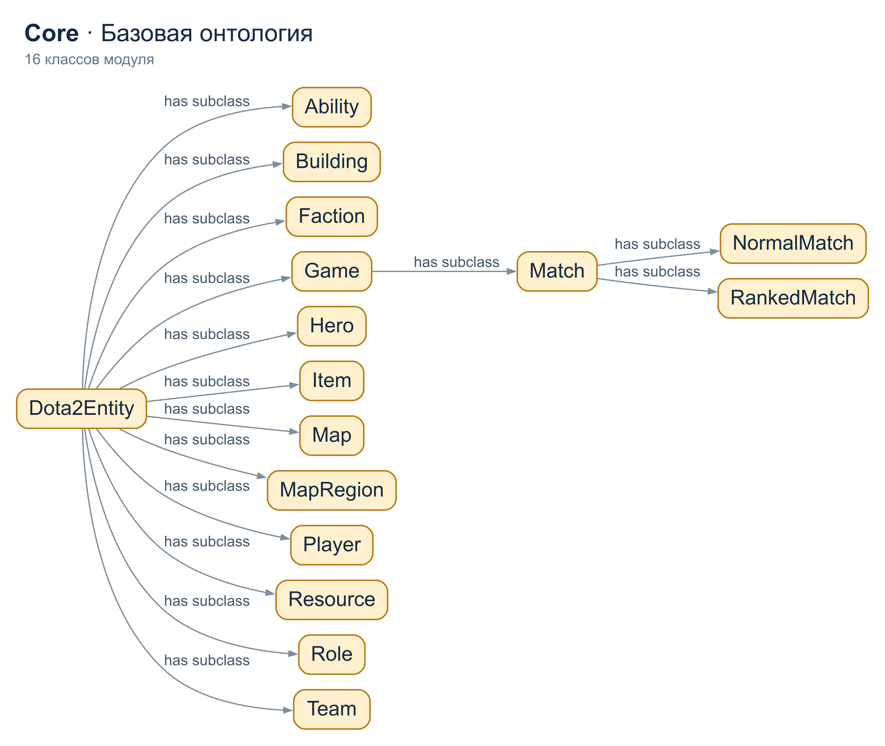
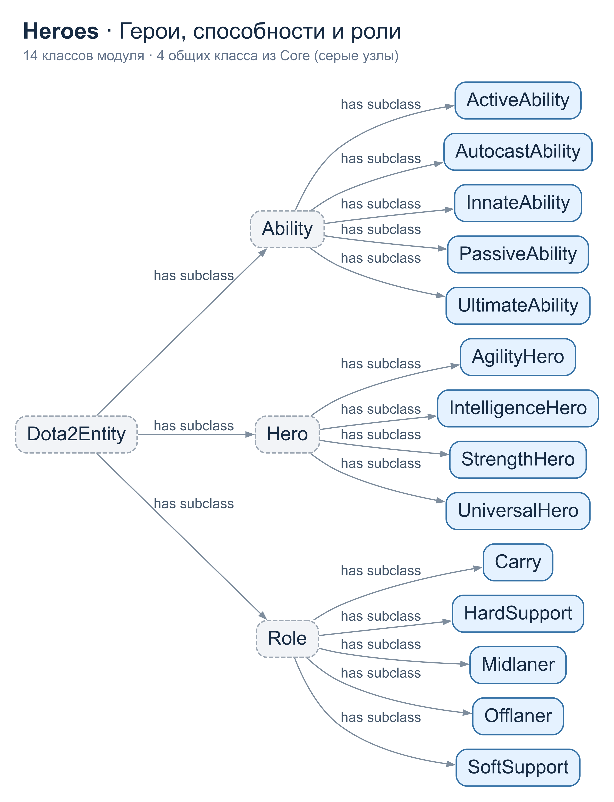
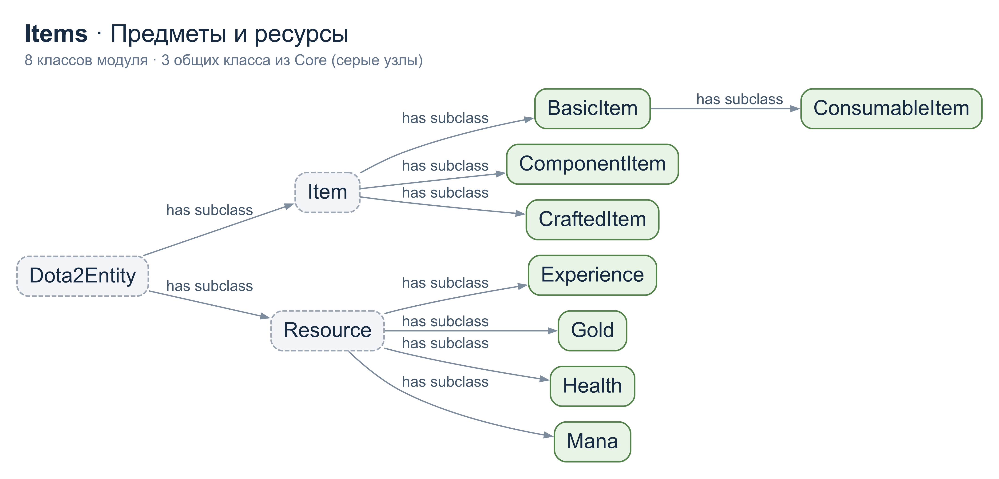
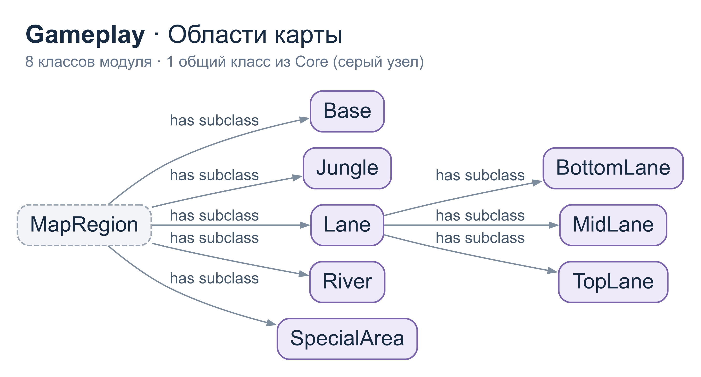
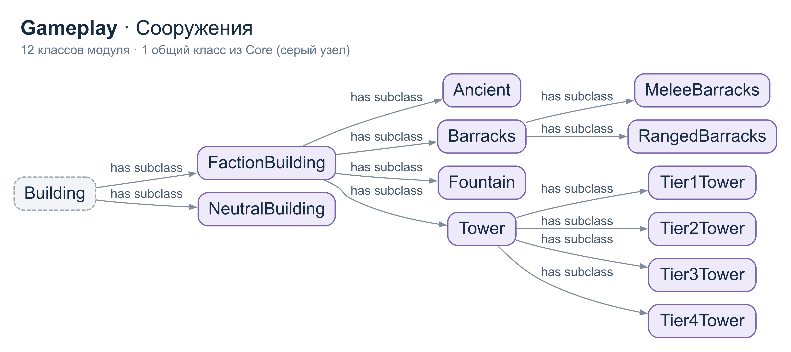
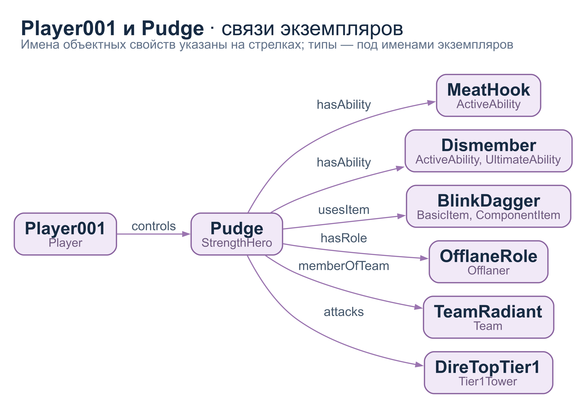

# Лабораторная работа №1. Онтологическое моделирование

## 1. Постановка задачи

**Задание:** построить онтологическое пространство из 3–4 связанных онтологий выбранной предметной области (слайд 6 [учебной презентации](not-repo/Системы%20ИИ_Лабы_вводная.ppt)). По слайду 30 отчёт включает теоретическую часть, постановку задачи, описание предметной области и разработанные онтологии.

**Цель работы:** представить знания об учебном матче Dota 2 в виде классов, экземпляров, свойств и ограничений OWL, связать предметные модули и проверить логические следствия модели в Protégé с помощью машины логического вывода (reasoner).

Предметная область выбрана потому, что в ней есть несколько связанных групп объектов: герои со способностями, предметы и ресурсы, игроки и команды, карта и сооружения. Онтология может служить основой справочника и отвечать на вопросы: каким героем управляет игрок, какие способности и предметы есть у героя, в какой команде он состоит и на какой карте проходит матч.

## 2. Описание предметной области

Dota 2 - командная игра. В рассматриваемом сценарии две команды по пять игроков участвуют в одном матче. Игрок управляет героем, у героя есть способности, роль и используемые предметы. На карте расположены области и сооружения, принадлежащие фракциям Radiant и Dire.

Модель описывает **снимок одного учебного матча `Match001` продолжительностью 42 минуты**. В данных записаны 10 игроков, 10 героев, 20 способностей, 11 предметов, две команды, одна карта, девять областей карты и 17 сооружений. Остальные экземпляры представляют фракции, роли и ресурсы. Значения характеристик и наборы способностей демонстрационные, для каждого героя показаны только две способности. Модель предназначена для изучения онтологий и логического вывода.

Основные различия понятий:

- **Класс** описывает множество объектов: `Hero` - герои.
- **Подкласс** уточняет понятие: `StrengthHero` - герои силы, подкласс `Hero`.
- **Экземпляр** обозначает конкретный объект: `Pudge` - экземпляр `StrengthHero`.
- **Объектное свойство** связывает экземпляры: `Player001 controls Pudge`.
- **Свойство данных** связывает экземпляр с числом или строкой: `BlinkDagger hasCost 2250`.

Фракция и команда разделены: `Radiant` - экземпляр класса `Faction`, а `TeamRadiant` - команда конкретного матча. Аналогично, карта и её область - разные понятия: `Dota2Map hasRegion TopLaneArea`, при этом `Lane` является подклассом `MapRegion`.

## 3. Структура онтологического пространства

Созданы четыре OWL-онтологии в формате RDF/XML. В таблице учитываются только сущности, объявленные в соответствующем файле, без импортов и встроенных сущностей OWL.

| Модуль | Содержание | Прямые импорты | Классы | Объектные свойства | Свойства данных | Именованные экземпляры |
|---|---|---|---:|---:|---:|---:|
| [Dota2Core.rdf](Dota2Core.rdf) | Общие классы, связи и ограничения | - | 16 | 24 | 3 | 0 |
| [Dota2Items.rdf](Dota2Items.rdf) | Предметы, ресурсы, числовые характеристики | Core | 8 | 0 | 8 | 15 |
| [Dota2Heroes.rdf](Dota2Heroes.rdf) | Типы героев, способности, роли | Core, Items | 14 | 0 | 2 | 35 |
| [Dota2Gameplay.rdf](Dota2Gameplay.rdf) | Карта, сооружения, команды, игроки и матч | Core, Heroes, Items | 20 | 4 | 0 | 42 |
| **Всего** | | | **58** | **28** | **13** | **92** |

Связь между модулями задаётся через `owl:imports` и общие IRI сущностей. Например, класс `Hero` объявлен в Core, экземпляр `Pudge` - в Heroes, а его связь с командой `TeamRadiant` - в Gameplay. Это один и тот же `Pudge`, поскольку в обоих файлах используется одинаковый IRI.

Зависимости не образуют циклов: Gameplay использует Heroes и Items, Heroes использует Items, а все три модуля используют Core. **Core - базовый предметный модуль Dota 2**. Метаонтология, согласно лекции, содержит понятия, независимые от предметной области; отдельный такой модуль здесь не создавался.

Каталог [catalog-v001.xml](catalog-v001.xml) сопоставляет IRI онтологий четырём локальным файлам. Для просмотра всей модели нужно открыть **`Dota2Gameplay.rdf`**. Открытие одного Core не подключает зависимые от него модули.

### 3.1. Иерархия классов

Универсальный корень OWL - `owl:Thing`, пользовательский корень модели - `Dota2Entity`. Его ветви включают героев, способности, предметы, ресурсы, игроков, команды, фракции, роли, игры, карты, области карты и сооружения.

| Ветвь | Основные подклассы |
|---|---|
| `Hero` | `StrengthHero`, `AgilityHero`, `IntelligenceHero`, `UniversalHero` |
| `Ability` | `ActiveAbility`, `PassiveAbility`, `UltimateAbility`, `InnateAbility`, `AutocastAbility` |
| `Item` | `BasicItem`, `CraftedItem`, `ComponentItem`; `ConsumableItem` - подкласс `BasicItem` |
| `Resource` | `Gold`, `Experience`, `Health`, `Mana` |
| `Game` | `Match`, далее `RankedMatch` и `NormalMatch` |
| `MapRegion` | `Lane`, `Jungle`, `River`, `Base`, `SpecialArea`; линии делятся на верхнюю, центральную и нижнюю |
| `Building` | `FactionBuilding`, `NeutralBuilding`; сооружения фракции включают башни, казармы, Древнего и фонтан |

Четыре типа героев попарно непересекаются. Категории способностей могут пересекаться: например, `Dismember` имеет типы `ActiveAbility` и `UltimateAbility`. `ComponentItem` тоже допускает пересечение: `BlinkDagger` одновременно базовый предмет и компонент сборки. Подклассы могут оставаться без именованных экземпляров: это заготовка словаря для расширения модели.

### 3.2. Свойства и ограничения

Примеры объектных свойств:

| Свойство | Domain: тип субъекта | Range: тип объекта | Обратное свойство |
|---|---|---|---|
| `controls` | `Player` | `Hero` | `controlledBy` |
| `belongsTo` | `Player` | `Team` | `hasPlayer` |
| `participatesIn` | `Player` | `Match` | `hasParticipant` |
| `hasAbility` | `Hero` | `Ability` | `abilityOf` |
| `usesItem` | `Hero` | `Item` | `usedBy` |
| `memberOfTeam` | `Hero` | `Team` | `hasHero` |
| `hasTeam` | `Match` | `Team` | `competesIn` |
| `takesPlaceOn` | `Match` | `Map` | `hostsMatch` |
| `hasRegion` | `Map` | `MapRegion` | `isRegionOf` |

Domain и range позволяют выводить типы участников связи. Например, из `x controls y` следует, что `x` - игрок, а `y` - герой. Они не проверяют заполненность полей как ограничения таблицы базы данных.

Свойства данных включают `hasName` и `hasNickname` с диапазоном `xsd:string`, а также `hasCost`, `hasLevel`, `hasHealth`, `hasMana`, `hasDurationMinutes` и другие числовые свойства с диапазоном `xsd:integer`.

Основные ограничения в синтаксисе Manchester:

```text
Hero SubClassOf hasAbility some Ability
Hero SubClassOf usesItem some Item
Hero SubClassOf hasRole some Role
Player SubClassOf controls some Hero
Player SubClassOf belongsTo some Team
Player SubClassOf participatesIn some Match
Match SubClassOf takesPlaceOn exactly 1 Map
Match SubClassOf hasTeam exactly 2 Team
```

`some` означает существование хотя бы одного связанного объекта указанного класса. `exactly` задаёт точное число различных объектов этого класса. В Core также явно записано `Match SubClassOf takesPlaceOn some Map`; при наличии `exactly 1 Map` это логически избыточное, но совместимое ограничение.

## 4. Пример работы модели

Следующий фрагмент объединяет факты из всех четырёх модулей. Здесь использована сокращённая запись связей, а не отдельный RDF-файл.

```text
Player001 controls Pudge
Player001 belongsTo TeamRadiant
Player001 participatesIn Match001
Pudge rdf:type StrengthHero
Pudge hasAbility MeatHook
Pudge hasAbility Dismember
Pudge hasRole OfflaneRole
Pudge usesItem BlinkDagger
Pudge memberOfTeam TeamRadiant
BlinkDagger hasCost 2250
Match001 hasTeam TeamRadiant
Match001 hasTeam TeamDire
Match001 takesPlaceOn Dota2Map
```

Модель позволяет получить следующие ответы:

| Вопрос | Ответ по записанным данным или логическому выводу |
|---|---|
| Каким героем управляет `Player001`? | `Pudge` |
| Какие способности записаны у `Pudge`? | `MeatHook`, `Dismember` |
| Какой предмет использует `Pudge` и какова его стоимость? | `BlinkDagger`, 2250 единиц золота |
| В какой команде состоит `Pudge`? | `TeamRadiant`, связь `memberOfTeam` записана явно |
| Кто управляет `Pudge`, если спросить через `controlledBy`? | `Player001`, вывод по обратному свойству `controls` |
| Является ли `Pudge` героем? | Да, через `StrengthHero SubClassOf Hero` |
| Какие команды участвуют в `Match001` и на какой карте? | `TeamRadiant` и `TeamDire`, карта `Dota2Map` |

## 5. Деревья онтологий

Стрелка **`A -> B` с подписью `has subclass`** читается как «у класса A есть подкласс B». Это обозначение OntoGraf для аксиомы **`B rdfs:subClassOf A`**; отдельного объектного свойства `has subclass` в модели нет. Деревья отражают иерархию, а объектные свойства между экземплярами показаны на *рисунке 6*.

### 5.1. Core: базовые понятия



*Рисунок 1. Все 16 классов Core: корень `Dota2Entity`, 12 основных ветвей и уточнение `Game → Match → NormalMatch / RankedMatch`.*

### 5.2. Heroes: герои, способности и роли



*Рисунок 2. Все 14 классов Heroes: четыре типа героев, пять категорий способностей и пять игровых ролей. Общие классы `Dota2Entity`, `Hero`, `Ability` и `Role` подключены из Core.*

### 5.3. Items: предметы и ресурсы



*Рисунок 3. Все восемь классов Items. `ConsumableItem` уточняет `BasicItem`; `Gold`, `Experience`, `Health` и `Mana` относятся к ресурсам. `Item`, `Resource` и общий корень объявлены в Core.*

### 5.4. Gameplay: области карты



*Рисунок 4. Ветвь `MapRegion`: восемь классов Gameplay, описывающих области карты и три вида линий. Показана классификация областей; принадлежность конкретной области карте задаётся отдельным свойством `hasRegion`.*

### 5.5. Gameplay: сооружения



*Рисунок 5. Остальные 12 классов Gameplay: сооружения фракций и нейтральные сооружения, типы казарм и четыре уровня башен. Рисунки 4 и 5 вместе показывают все 20 классов модуля.*

### 5.6. Именованные отношения: игрок и герой



*Рисунок 6. Фрагмент фактов объединённой модели, размещённый в виде дерева: `Player001` управляет `Pudge`, у героя указаны способности, предмет, роль, команда и атакуемая башня. Узлы обозначают экземпляры; под именами перечислены их явно записанные типы. На стрелках стоят реальные имена объектных свойств. Все семь связей явно присутствуют в RDF-файлах; остальные связи этих экземпляров опущены для читаемости.*

Исходные DOT-файлы и способ повторного экспорта описаны в [папке иллюстраций](docs/ontologies/README.md).

## 6. Вывод

Построено онтологическое пространство Dota 2 из четырёх связанных OWL-модулей. Модель объединяет описание классов с данными учебного матча, использует наследование, объектные свойства, свойства данных, непересекаемость и ограничения количества связей. На примере `Player001` и `Pudge` показано, как сведения из разных модулей позволяют находить связи и получать логические следствия.

## Теоретическая часть: ответы к лекции
Ответы на 15 вопросов со слайда 29 учебной презентации.

1. **Понятие онтологии.** В философии - учение о бытии; в ИИ - описание понятий области, их связей и ограничений.
2. **Определение.** По Груберу, онтология - **формальная спецификация концептуализации**. Концептуализация - система понятий и связей; формальность позволяет обрабатывать её машинно. По FIPA - словарь области и логические высказывания, определяющие его смысл и ограничения.
3. **Модели.** `O = ⟨X, R, F⟩`: конечные множества понятий, отношений и функций интерпретации. При пустых `R` и `F` - словарь. `Z = ⟨O, P, M⟩`: онтология верхнего уровня, предметные онтологии/онтологии задач, машина вывода. В работе - предметные модули и HermiT; отдельной метаонтологии нет.
4. **Классификация.** Метаонтология - общие понятия; предметная - конкретная область; задач и методов - задачи и подзадачи; прикладная - область вместе с задачей приложения; сетевая - результаты действий (по лекции). Наша модель - предметная.
5. **Аспекты термина.** Философское понятие; неформальная концептуальная система; формальный взгляд на семантику; спецификация концептуализации; логическая теория; словарь теории; спецификация теории на метауровне.
6. **Онтология в информатике.** Машиночитаемая схема классов, связей и ограничений. Таксономия задаёт только классификацию; онтология дополнительно описывает отношения и аксиомы.
7. **Направления применения.** Представление и совместное использование знаний, общая терминология, классификация, семантическая интеграция, поиск и вывод новых фактов.
8. **Практическое применение.** Порталы, сбор информации, корпоративные ресурсы, обучающие системы, энциклопедии, взаимодействие устройств. Для Dota 2 - справочник героев и предметов.
9. **Направления развития.** Улучшение доступа к знаниям, средств разработки и представления, автоматического вывода онтологий и взаимодействия между ними.
10. **Языки.** Традиционные: LOOM, OCML, Flogic; специальные: Ontolingua, CycL, SHOE; Web-стандарты: XML, RDF, RDFS, OWL. XML - синтаксис, RDF - граф утверждений, RDFS - базовая схема, OWL - логические аксиомы. В работе: OWL, записанный в RDF/XML.
11. **OWL.** Web Ontology Language - язык классов, свойств, экземпляров и аксиом. Поддерживает обратные свойства, непересекаемость и ограничения; в работе средствами OWL 2 ограничено число команд и карт матча.
12. **Критерии Грубера.** Ясность; согласованность; расширяемость; минимум влияния кодирования; минимальное онтологическое соглашение - только необходимые предположения, без лишних ограничений.
13. **Жизненный цикл.** Планирование -> разработка (спецификация, концептуализация, формализация, реализация, проверка) -> поддержка. Поддержка идёт и во время разработки.
14. **Уровни формализации.** Неформализованный - естественный язык; неформально-структурированный - упорядоченная ограниченная лексика; полуформальный - специальный формально определённый язык; строго формальный - формальная семантика и доказательства свойств. По критериям лекции работа - полуформальная: отдельных доказательств полноты нет.

15. **Этапы разработки.** Определить классы, слоты (свойства), допустимые значения и ограничения, иерархию и остальные отношения. Затем заполнить экземпляры и проверить модель.

### Термины OWL и решения, принятые в модели

**Класс, подкласс, экземпляр?** `Hero` - класс, `StrengthHero` - его подкласс, `Pudge` - экземпляр `StrengthHero`. Универсальный корень OWL - `owl:Thing`, пользовательский - `Dota2Entity`.

**Почему названия в одинарных кавычках?** Protégé обрамляет названия с пробелами: `'Базовый предмет'`, но `Золото`. Это оформление, а не часть IRI или признак другого вида класса. Чтобы видеть `BasicItem` вместо русской метки, выберите **View -> Render by entity IRI short name**.

**Object Property и Data Property?** Первое связывает объекты: `Pudge usesItem BlinkDagger`. Второе - объект и литерал: `BlinkDagger hasCost "2250"^^xsd:integer`.

**RDF-тройка и IRI?** Тройка - субъект, предикат, объект: `Player001 controls Pudge`. IRI - идентификатор сущности; префикс сокращает его запись, название не заменяет идентификатор.

**Domain и range?** Для `controls`: `Player` и `Hero`. Из `x controls y` выводятся соответствующие типы. Это аксиомы вывода, а не проверка заполненности данных.

**`some`, `only`, `exactly`?** `some` - хотя бы одно значение указанного класса; `only` - все значения этого класса, но их может не быть; `exactly n` - ровно `n` различных значений указанного класса.

**Открытый мир?** Отсутствие факта не означает его ложность. Если способность героя не записана, `some Ability` допускает неизвестную способность; reasoner не обязан создавать именованный объект.

**Разные IRI - разные объекты?** Не обязательно. Различие задаётся `differentFrom`/`AllDifferent`. Команды явно различены; игроки - нет. Третья команда нарушит `exactly 2`, если все три попарно различны; иначе она может обозначать одну из двух.

**Что выводит reasoner?** Проверяет согласованность и выводит следствия: `Pudge` является `Hero`; из `Player001 controls Pudge` выводится `Pudge controlledBy Player001`. Согласованность не доказывает полноту модели или соответствие правилам игры.

**Непересекаемость?** Один объект не может принадлежать двум непересекающимся классам. Типы героев попарно непересекаются: добавление Pudge типа `AgilityHero` создаст противоречие. `Dismember` может быть одновременно активной и ультимативной способностью.

**Наследование и часть–целое?** Линия - часть карты, а не разновидность карты: `Lane SubClassOf MapRegion`, `Dota2Map hasRegion TopLaneArea`. Связь «часть–целое» задана свойством `hasRegion`, а связь «вид–род» - `SubClassOf`.

**Почему фракция отдельно от команды?** `Radiant` - экземпляр `Faction`; `TeamRadiant` - команда матча, связанная с ней через `representsFaction`. Аналогично, `Gold` - класс, `Match001GoldResource` - его экземпляр.

**Все связи выводятся автоматически?** Нет. Членство героя в команде записано через `memberOfTeam`; из управления героем и членства игрока без цепочки свойств оно не выводится. `SubClassOf` задаёт необходимое условие, `EquivalentTo` - оба направления; последнего в модели нет.

**Какие упрощения?** По пять игроков записано, но точная численность команды не ограничена. `controls some Hero` не означает одного героя. Предметы - справочные индивиды без отдельных копий; изменения состояния во времени не моделируются.

**SPARQL и reasoner?** SPARQL ищет данные в графе, reasoner выводит следствия. Без вывода запрос по типу `Hero` может пропустить Pudge, явно типизированного как `StrengthHero`; нужен путь `rdf:type/rdfs:subClassOf*`. Граф запроса должен включать нужные модули.


## Как воспроизвести демонстрацию

1. Разместить четыре RDF-файла и `catalog-v001.xml` в одной папке и открыть **`Dota2Gameplay.rdf`** в Protégé.
2. В **Active Ontology → Ontology imports** проверить Core, Heroes и Items.
3. В **Entities → Classes** показать иерархию классов и ограничения `Hero` и `Match`.
4. В **Entities → Object properties** выбрать `controls` и показать domain, range и обратное свойство `controlledBy`.
5. В **Entities → Individuals** выбрать `Pudge` и показать его способности, предмет и команду.
6. Выбрать **Reasoner → HermiT → Start reasoner**. Для проверки наследования и обратной связи открыть `Pudge` и включить показ выводимых аксиом.
7. Для графа включить **Window → Tabs → OntoGraf**. Выбрать класс слева, нажать на его узел в графе правой кнопкой и выбрать **Expand**. Кнопка с домиком помещает весь граф в видимую область. Для отдельного фрагмента ввести `Pudge` в поле Search и нажать **Search**. При наложении узлов выбрать другую раскладку на панели инструментов.
8. Для сохранения связей с названиями использовать **Export graph to DOT** на панели OntoGraf. Инструкции по получению деревьев в PNG и SVG приведены [рядом с изображениями](docs/ontologies/README.md).

В интерфейсе русские подписи берутся из `rdfs:label`. Чтобы сопоставить их с идентификаторами в отчёте, выбрать **View → Render by entity IRI short name**.